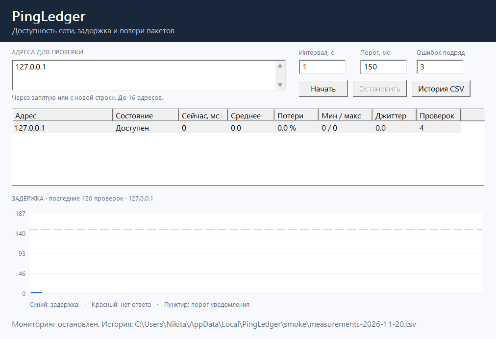

# PingLedger

[Русский](README.md)

A native Windows network monitor built with C++17 and WinAPI. Track ICMP latency and packet loss across several hosts, inspect a live chart, receive tray notifications and keep CSV measurements locally.



## Features

- Monitor 1 to 16 IPv4 addresses or ASCII domains concurrently.
- Configurable check interval, latency threshold and consecutive-failure threshold.
- Current, average, minimum and maximum RTT, loss percentage and check count.
- Jitter defined as the mean absolute difference between adjacent successful measurements in the last 120 checks; failed checks break pairs.
- Selected-host chart with the last 120 measurements; failed requests remain visible as gaps.
- Tray operation and transition notifications for high latency, unavailability and recovery.
- CSV persistence, write-error reporting and saved settings.
- No application account, subscription or cloud backend.

The interface is in Russian. A useful workflow is to monitor a local gateway, an external host and a game server at the same time, then compare where failures appear.

## Build and run

Windows 10/11 x64. The MinGW build is a standalone executable. Download the ready-to-run ZIP from Releases. The CI template is in `ci/build.yml`; move it to `.github/workflows/build.yml` with workflow permissions to enable automatic CI. It is currently not enabled.

With MSYS2 UCRT64 GCC:

```powershell
powershell -NoProfile -ExecutionPolicy Bypass -File .\build.ps1 -Test
.\build\PingLedger.exe
```

The execution-policy flag applies to this PowerShell process only. The script looks for `g++` in PATH, then in `C:\msys64\ucrt64\bin`.

With Visual Studio 2022 Build Tools and CMake:

```powershell
cmake -S . -B build -A x64
cmake --build build --config Release
ctest --test-dir build -C Release --output-on-failure
.\build\Release\PingLedger.exe
```

Enter hosts separated by commas, whitespace or semicolons. Click «Начать» to start, «Остановить» to stop and «История CSV» to open the data folder. Select a row to change the chart. Minimize to keep monitoring in the tray, double-click the tray icon to restore, right-click for the exit menu. Closing the window exits. Starting again resets the displayed statistics and appends to the existing CSV.

## Storage and privacy

`%LOCALAPPDATA%\PingLedger\settings.ini` stores settings. `measurements-YYYY-MM-DD.csv` stores samples; the filename uses the session start date and timestamps use local time. Files are appended and are not automatically removed. UI statistics cover the current monitoring session; the chart retains 120 points.

The application makes DNS requests and ICMP requests to your configured hosts. It does not upload measurements or settings. Review host addresses before sharing your CSV files.

## Tests

`build.ps1 -Test` runs 19 checks covering validation, deduplication, statistics, jitter, outage and recovery states, bounded history, CSV escaping, a real ICMP loopback request and a DNS failure. A separate hidden GUI smoke test creates the native controls, collects at least two successful loopback samples, writes CSV, stops the worker and renders the interface to BMP. Smoke artifacts use the isolated `%LOCALAPPDATA%\PingLedger\smoke` directory.

## Scope and limitations

IPv4 ICMP only. No IPv6, TCP/HTTP checks, VPN-adapter detection or route tracing. A missing ICMP response is not proof of an internet or VPN outage. A server or firewall may intentionally reject ping. A low RTT is not a game-service availability check.

Each ICMP request has a one-second timeout. Windows DNS resolution has its own timeout and can take longer; shutdown waits for current operations. Configured intervals are between cycle starts; a long cycle delays the next cycle. Tray notifications can be suppressed by Windows settings and Do Not Disturb. Verify on-screen notifications manually on the target machine.

## Source layout

- `include/monitor.hpp`: statistics, health transitions, input parsing and CSV.
- `include/probe.hpp`: RAII Winsock and ICMP wrappers.
- `src/main.cpp`: GUI, chart, tray, worker and settings.
- `tests/core_tests.cpp`: logic and network checks.
- `build.ps1`, `CMakeLists.txt`: GCC and MSVC builds.

## Author and license

Nikita, [Fr1bilder](https://github.com/Fr1bilder), <nikitazadan89@yandex.ru>.

MIT. See [LICENSE](LICENSE).
