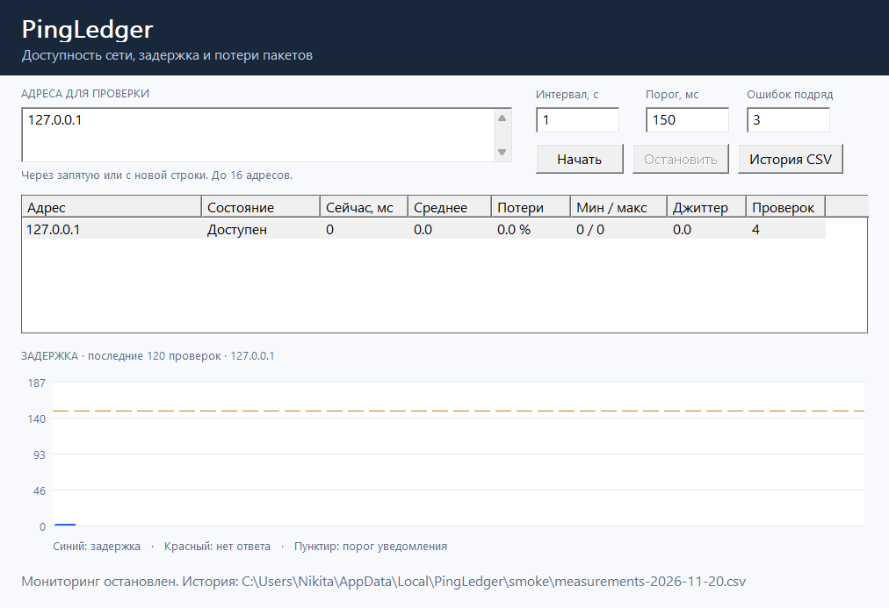

# PingLedger

[English](README.en.md)

Настольный монитор соединения для Windows на C++17 и WinAPI. Показывает задержку, потери и стабильность ответа нескольких узлов, сохраняет измерения в CSV и уведомляет об ухудшении связи.



## Для чего

Проверить соединение перед матчем, сравнить доступность домашнего шлюза и внешнего сервера, собрать историю задержек для диагностики. Можно добавить адрес сервера, доступного только через VPN, и наблюдать за его доступностью.

## Возможности

- От 1 до 16 IPv4-адресов или ASCII-доменов. Разделители: запятая, пробел, точка с запятой, новая строка. Дубликаты убираются.
- Параллельные ICMP-проверки с тайм-аутом ответа 1 секунда. Интервал между началами циклов настраивается от 1 до 3600 секунд; если цикл длится дольше интервала, следующий начинается после завершения.
- Текущая, средняя, минимальная и максимальная задержка; потери пакетов; число проверок.
- Джиттер как средняя абсолютная разница соседних успешных измерений в последних 120 проверках. Через пропуск пары не соединяются.
- График последних 120 проверок выбранного узла. Пропуски отмечаются красным и не соединяются линией.
- Порог задержки и число неудачных проверок до объявления недоступности.
- Системные уведомления при переходе в состояние высокой задержки, недоступности и восстановления.
- Сворачивание в трей. Двойной щелчок открывает окно; правый щелчок показывает меню выхода.
- CSV с датой, адресом, результатом, задержкой и техническими подробностями. Ошибки записи отображаются в строке состояния.
- Сохранение настроек между запусками. Без аккаунта, подписки и внешнего сервера приложения.

## Быстрый старт

Windows 10/11 x64. Собранный `PingLedger.exe` запускается без установки. Готовый архив доступен в разделе Releases. Шаблон CI сохранён в `ci/build.yml`; для включения перенеси его в `.github/workflows/build.yml` с доступом к workflows. Автоматический CI пока не включён.

Для сборки из исходников установи GCC из MSYS2 UCRT64. PowerShell:

```powershell
powershell -NoProfile -ExecutionPolicy Bypass -File .\build.ps1 -Test
.\build\PingLedger.exe
```

`ExecutionPolicy Bypass` применяется только к этому процессу PowerShell и не меняет политику системы. Скрипт ищет `g++` в PATH, затем в `C:\msys64\ucrt64\bin`.

Альтернативная сборка с Visual Studio 2022 Build Tools и CMake:

```powershell
cmake -S . -B build -A x64
cmake --build build --config Release
ctest --test-dir build -C Release --output-on-failure
.\build\Release\PingLedger.exe
```

Введи адреса, задай интервал и пороги, нажми «Начать». Выбери строку, чтобы посмотреть график. Кнопка «История CSV» открывает папку измерений. Закрытие окна завершает процесс; кнопка сворачивания оставляет его в трее. Новый запуск мониторинга начинает новую статистику в интерфейсе, предыдущие CSV сохраняются.

## Данные

Данные хранятся в `%LOCALAPPDATA%\PingLedger`:

```text
settings.ini                    настройки
measurements-YYYY-MM-DD.csv      журнал, дата начала сеанса
```

Статистика таблицы считается с последнего нажатия «Начать», график ограничен 120 точками. Журнал дописывается в существующий файл той же даты. Время в CSV локальное. Файлы автоматически не удаляются: их размер нужно контролировать при длительном мониторинге.

```csv
timestamp,target,status,latency_ms,detail
"2026-11-20 12:00:00","127.0.0.1",ok,0,"127.0.0.1"
"2026-11-20 12:00:03","192.0.2.1",failed,,"ICMP error 11010"
```

Измерения и настройки не отправляются в облако. Программа делает DNS-запросы для доменов и ICMP-запросы к указанным узлам. Перед публикацией собственных журналов проверь содержащиеся в них адреса.

## Проверка

`build.ps1 -Test` запускает:

1. 19 проверок: нормализация и валидация адресов, потери, средняя задержка, джиттер, переходы состояний, ограничение истории, CSV, реальный ICMP-запрос к `127.0.0.1`, ошибка DNS.
2. Скрытый GUI smoke-тест: создание окна и элементов управления, фоновый мониторинг loopback, как минимум два успешных ответа, запись CSV, остановка и отрисовка интерфейса в BMP.

Артефакты smoke-теста находятся в `%LOCALAPPDATA%\PingLedger\smoke`. Тест не перезаписывает рабочие настройки. Для ручной проверки уведомлений укажи недоступный адрес своей тестовой сети и дождись заданного числа неудачных проверок. Проверка появления уведомления на экране вручную обязательна: Windows может подавлять его настройками уведомлений.

## Ограничения

- Только IPv4 и ICMP. Доступность TCP/HTTP, IPv6, состояние VPN-интерфейса и трассировка маршрута в эту версию не входят.
- Отсутствие ICMP-ответа не доказывает отключение интернета или VPN: сервер или брандмауэр может блокировать ping. Низкий ping также не гарантирует доступность игрового приложения.
- Используется стандартное разрешение DNS Windows, его ожидание может превышать ICMP-тайм-аут. Остановка корректно дожидается текущих сетевых операций.
- Уведомления реализованы через системный значок трея, не через отдельный оверлей. Их видимость зависит от Windows и режима «Не беспокоить».
- Сводные метрики не загружаются из предыдущих CSV. В интерфейсе отображается текущий сеанс.

## Структура

```text
include/monitor.hpp     статистика, состояния, адреса и CSV
include/probe.hpp       RAII-обёртки Winsock и ICMP
src/main.cpp            окно, график, трей, рабочий поток, настройки
tests/core_tests.cpp    проверки ядра и сетевые проверки
build.ps1               сборка GCC и проверка
CMakeLists.txt          сборка CMake, включая MSVC
```

## Автор и лицензия

Никита, [Fr1bilder](https://github.com/Fr1bilder), <nikitazadan89@yandex.ru>.

MIT. См. [LICENSE](LICENSE).
